# Zona inicial — Praderas del Alba

> Diseño de la zona donde se prueba la progresión y primer cuadrante del
> supermapa. Es un plan para armar en el editor sobre `praderas_del_alba.tscn`,
> no algo ya implementado. Las ilustraciones están hechas con el arte real del
> mapeador (`game/assets/`), con el mismo autotile de terreno (`BiomeTileset`)
> y de vallas (`FenceAutotiler`) que usa el juego. Ver
> [Cómo regenerar las ilustraciones](#cómo-regenerar-las-ilustraciones).
>
> Algunas piezas son **provisorias** y se van a reemplazar: la herrería, los
> puestos de mercado y los muelles. Están puestas para ocupar su lugar en el mapa.
>
> Esta zona es la milestone M1 del [roadmap](ROADMAP.md).

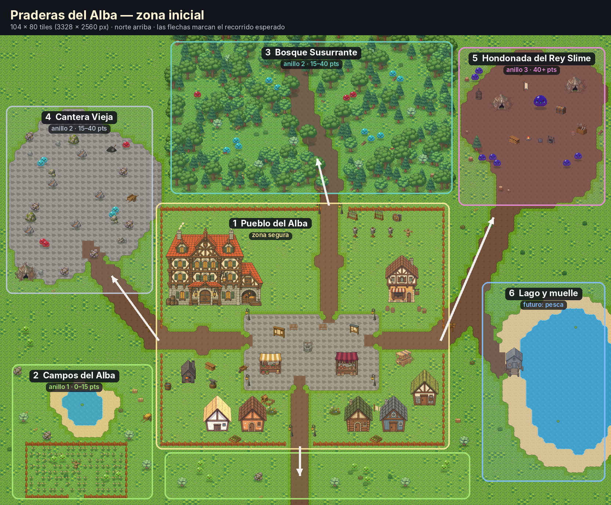

Mapa completo a mitad de escala (4000×3000), para mapear mirándolo al lado:
[`00_mapa_completo_mitad.png`](img/zona_inicial/00_mapa_completo_mitad.png).

---

## Punto de partida

`praderas_del_alba.tscn` es la escena que abre "Nuevo Juego"
(`main_menu.gd` → `ZONE_SCENE`), y es la que se va a ir llenando. Mide
**8000 × 6000 px (250 × 188 tiles)**, el `world_size` que ya tiene la escena,
y este diseño ocupa ese espacio entero.

En la versión subida al repo, esa escena tiene 6 casas (`BuildingMarker`) y las
capas de pintura, pero ningún `MobSpawnMarker` ni `ResourceNodeMarker`. Los
markers de mobs y recursos que hay en el repo están en `pradera.tscn`, la zona
de prueba. Si en tu máquina ya hay slimes en Praderas del Alba, son cambios que
todavía no se subieron.

## Para qué existe esta zona

Tiene que contestar, jugándola, estas preguntas:

1. **¿Se siente el avance?** Volver al anillo 1 después de una hora tiene que
   sentirse fácil.
2. **¿El primer descubrimiento "1 de 3" llega a tiempo?** Tiene que pasar antes
   de que el anillo 1 aburra.
3. **¿Cada anillo pide algo distinto?** No "lo mismo con más vida": cada zona
   entrena una habilidad del jugador (pegar, esquivar, gestionar recursos).
4. **¿Vale la pena volver al pueblo?** Vender, craftear, curarse y guardar
   tienen que estar a pocos pasos.
5. **¿El farm activo le gana al AFK?** Las venas con G contra el golpe a mano
   (+20%).

## Estructura

- **Un pueblo de puerto** al oeste, sobre una bahía que abre al mar del sur.
- **Anillos de dificultad que se alejan del pueblo:** los campos pegados al
  este, el bosque al norte y la cantera al este (anillo 2), y la hondonada en
  la esquina noreste (anillo 3). "Más lejos" es "más peligroso" sin tener que
  explicarlo.
- **Caminos de tierra** (pincel TERRENO → barro) que conectan todo y siguen
  hasta los bordes: cada uno es una **salida a un cuadrante vecino**.

| # | Zona | Anillo | Skill objetivo (puntos) | Qué entrena |
|---|---|---|---|---|
| 1 | Pueblo del Alba | seguro | — | Volver, vender, craftear, guardar |
| 2 | Campos del Alba | 1 | 0 → 15 | Los controles: pegar, recolectar, primer craft |
| 3 | Bosque Susurrante | 2 | 15 → 40 | Combate contra varios, esquivar proyectiles |
| 4 | Cantera Vieja | 2 | 15 → 40 | Minería (venas inmortales) bajo presión |
| · | Lomas del Este | 1 → 3 | 25 → 40 | Transición: azules sueltos camino a la hondonada |
| 5 | Hondonada del Rey Slime | 3 | 40+ | Grupos fuertes y mini-jefe |
| 6 | Puerto y mar | — | — | Hoy decorado; después barco y pesca |
| 7 | Costa de las Gaviotas | — | — | Reservada para un anillo futuro |

## El ritmo esperado

Estos tiempos son **un objetivo para calibrar**, no un cálculo. Cuánto se tarda
de verdad depende de `skill_gain`, de los rendimientos decrecientes de
`Skills` y de cuánto tarda en morir cada mob. La idea es medirlo (ver
[Medir la progresión](#medir-la-progresión)) y mover los números hasta que
se parezca a esta tabla. Los umbrales 25/50/75 son los de
`DISCOVERY_THRESHOLDS` en `player.gd`.

| Minuto | Dónde | Qué debería pasar |
|---|---|---|
| 0–5 | Pueblo → Campos | Primeros slimes verdes, primer árbol talado, primera vuelta a vender |
| 5–15 | Campos | Primer arma crafteada en la herrería. ~15 pts en la skill de combate |
| 15–25 | Bosque o Cantera | **Primer descubrimiento (25 pts).** Primeros slimes rojos: aprender a esquivar |
| 25–45 | Bosque, Cantera, Lomas | Gear de hierro con las venas. **Segundo descubrimiento (50 pts)** |
| 45–60 | Hondonada | Packs violetas, primer intento al Rey Slime. Volver al anillo 1 se siente trivial |
| 60+ | Hondonada | Matar al jefe. **Tercer descubrimiento (75 pts)** |

---

## 1 · Pueblo del Alba

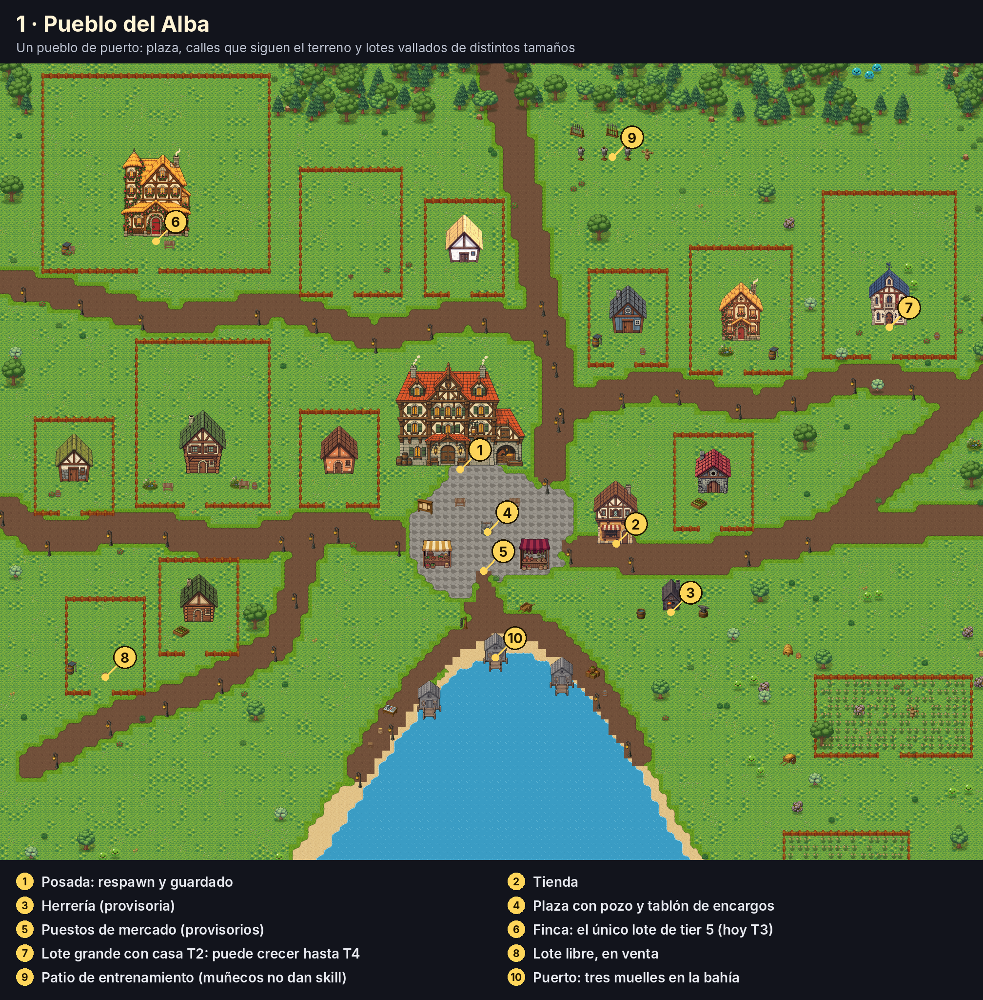

Sin muralla. El pueblo se arma alrededor de una plaza de piedra y de calles que
siguen el terreno; el borde lo marcan el bosque, los árboles sueltos y el mar.
Lo único vallado son **los lotes**.

| Pieza | Arte (id) | En el blockout | Después (milestone) |
|---|---|---|---|
| Posada | `inn` | Punto de spawn | Respawn al morir y guardado (M1) |
| Tienda | `general_goods` | `POIMarker` VENDOR, solo visual | Vender loot, comprar pociones (M4) |
| Herrería *(provisoria)* | `blacksmith_n` | `POIMarker` REPAIR | Craftear exige estar acá, en vez de la tecla C en cualquier lado (M4) |
| Plaza | pozo, `mega_quest_board_parchment_blank` | Decorado | El tablón es el primer NPC de quests: "matá X / traeme Y" (M4) |
| Puestos de mercado *(provisorios)* | `market_produce`, `market_spices` | Decorado | Vendedores especializados |
| Patio de entrenamiento | `mega_armor_stand_breastplate`, racks | `training_dummy` para probar kits | Igual. **No dan skill**: solo se sube al matar, recolectar o craftear |
| Lotes | ver abajo | Valla + casa actual, o cartel de "en venta" | Compra de lote y casa (M6) |

Las calles tienen nombre para poder hablar de ellas: **Calle del Bosque**
(norte), **Calle del Molino** (noreste), **Calle de las Gaviotas** (suroeste,
bajando hacia la costa) y el **Malecón**, que bordea la bahía.

### Lotes y tiers

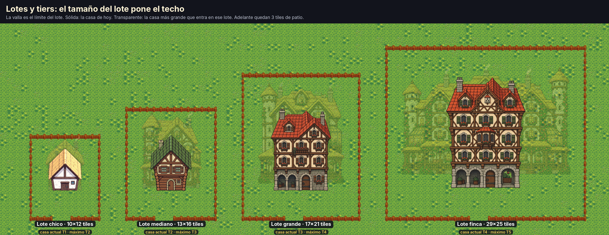

Cada casa vive en un lote, y **la valla es el límite del lote**. El tamaño del
lote pone el techo: una casa solo puede subir de tier mientras el sprite de ese
tier entre en el lote, con 3 tiles de patio adelante. Los tamaños salen de medir
los sprites del catálogo:

| Lote | Tamaño (tiles) | Tier máximo | Sprite del tier máximo |
|---|---|---|---|
| Chico | 10 × 12 | T2 | `house_medium_*` (224 × 288) |
| Mediano | 13 × 16 | T3 | `house_large_*` (320 × 416) |
| Grande | 17 × 21 | T4 | `house_grand_*` (448 × 576) |
| Finca | 29 × 25 | T5 | `house_palace_*` (864 × 704) |

`house_small_*` es T1. Así, el lote es la decisión de largo plazo (cuánto puede
crecer esa casa) y el tier es el progreso dentro de ese lote. Con el GDD
encaja así: subir de tier ya cuesta oro y materiales, el impuesto escala con el
tier, y ahora además el tier máximo depende de qué lote conseguiste.

En el pueblo hay **12 lotes**: 7 chicos, 2 medianos, 2 grandes y 1 finca. Dos
están **en venta** (un chico y un mediano). Las casas actuales mezclan tiers a
propósito, para que se vea que hay lugar para crecer: la finca tiene una casa
T3, y uno de los lotes grandes, una T2.

Esto responde una de las preguntas abiertas del GDD ("si los lotes son
parcelas prefabricadas iguales o polígonos hechos a mano"): **rectángulos de
cuatro tamaños fijos, ubicados a mano a lo largo de las calles.** Rectángulos
porque el vallado (`FenceAutotiler`) no hace diagonales, y tamaños fijos porque
son los que definen el tier máximo.

---

## 6 · Puerto y mar

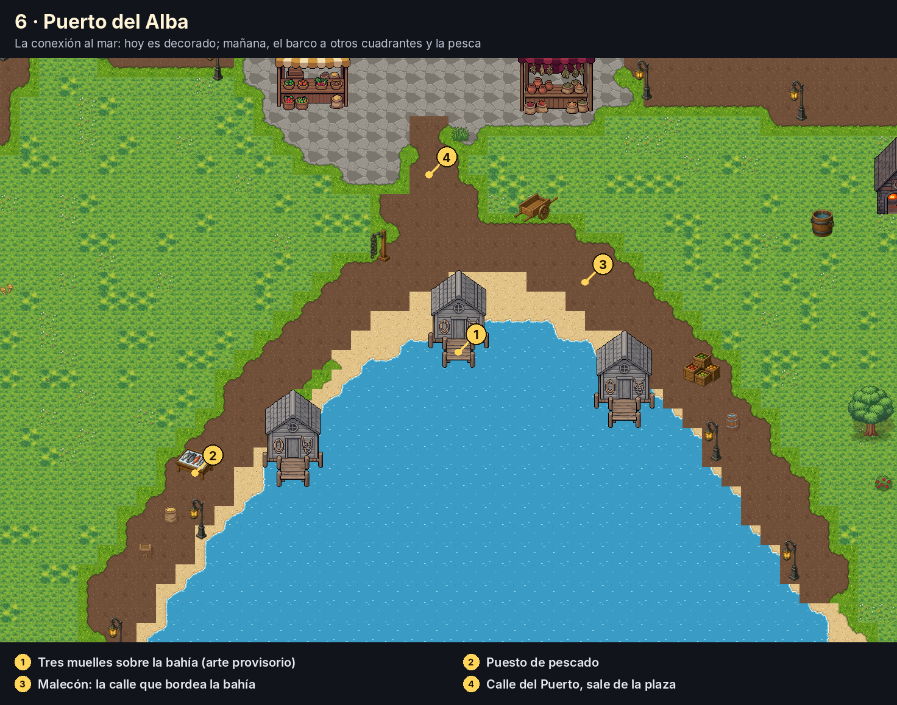

La bahía llega casi hasta la plaza: desde el pozo, el agua está a unos 15
tiles. La Calle del Puerto baja de la plaza al **Malecón**, que bordea la bahía,
y sobre el agua hay **tres muelles** con un puesto de pescado, cajas y un carro.

Por ahora es decorado. Lo que habilita después:

- **Ruta por mar** a otros cuadrantes (islas, otras costas): una salida más,
  además de las de tierra.
- **Pesca**, una de las skills de gathering del GDD.

---

## 2 · Campos del Alba (anillo 1)

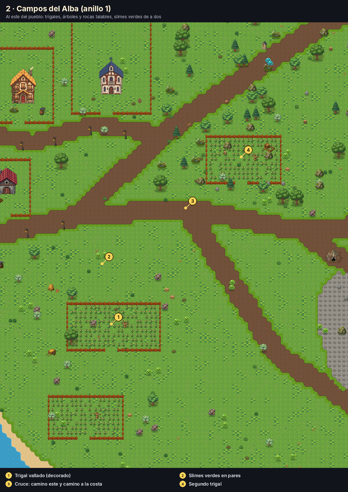

El primer contacto, al este del pueblo. Slimes verdes de a dos, lejos del camino
para que el jugador elija cuándo pelear. Árboles y rocas talables, tres
trigales vallados y colmenas como decorado.

- **Mobs:** ~34 slimes verdes en 17 pares.
- **Recursos:** ~25 árboles y rocas (no inmortales, respawn de ~6 s).

---

## 3 · Bosque Susurrante (anillo 2)

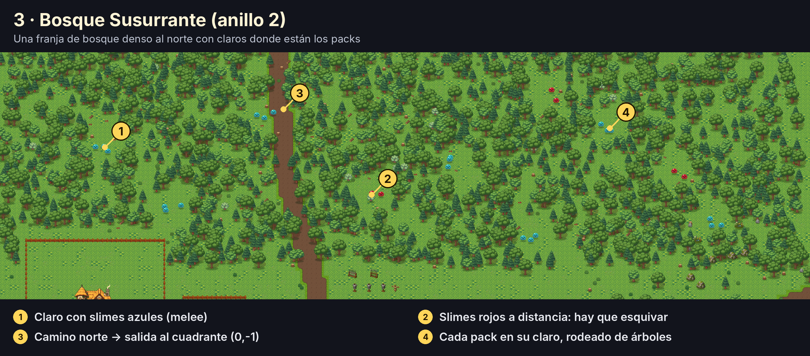

Una franja de bosque denso a lo ancho del norte. Los árboles decorativos
funcionan como pared y dejan **claros** donde están los packs, así que el
combate es en espacios chicos. Slimes azules en grupos de 3 y slimes rojos a
distancia: el primer lugar donde esquivar importa. El camino norte lo cruza y
sale al cuadrante (0,-1).

- **Mobs:** 21 azules en 7 packs y 6 rojos.
- **Recursos:** 16 árboles talables adentro.

## 4 · Cantera Vieja (anillo 2)

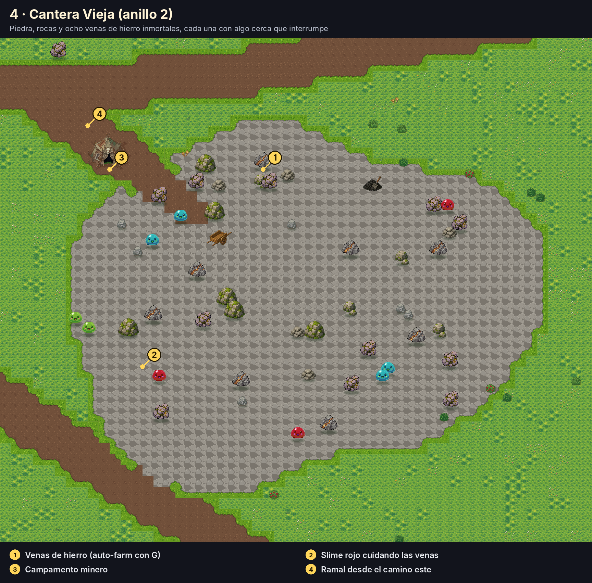

Terreno de piedra con rocas y **8 venas de hierro inmortales**. Cada vena tiene
cerca un slime rojo o un par de azules: el auto-farm con G es cómodo, pero te
interrumpen. Así, el golpe a mano además de rendir +20% te deja reaccionar.

- **Mobs:** 4 azules y 3 rojos.
- **Recursos:** ~10 rocas y 8 venas.

## Lomas del Este (transición)

Entre los campos y la hondonada: árboles sueltos, rocas, un santuario al
costado del camino y **tres parejas de slimes azules** sobre el camino noreste.
Es la rampa entre el anillo 1 y el 3, para que la hondonada no sea un salto.

## 5 · Hondonada del Rey Slime (anillo 3)

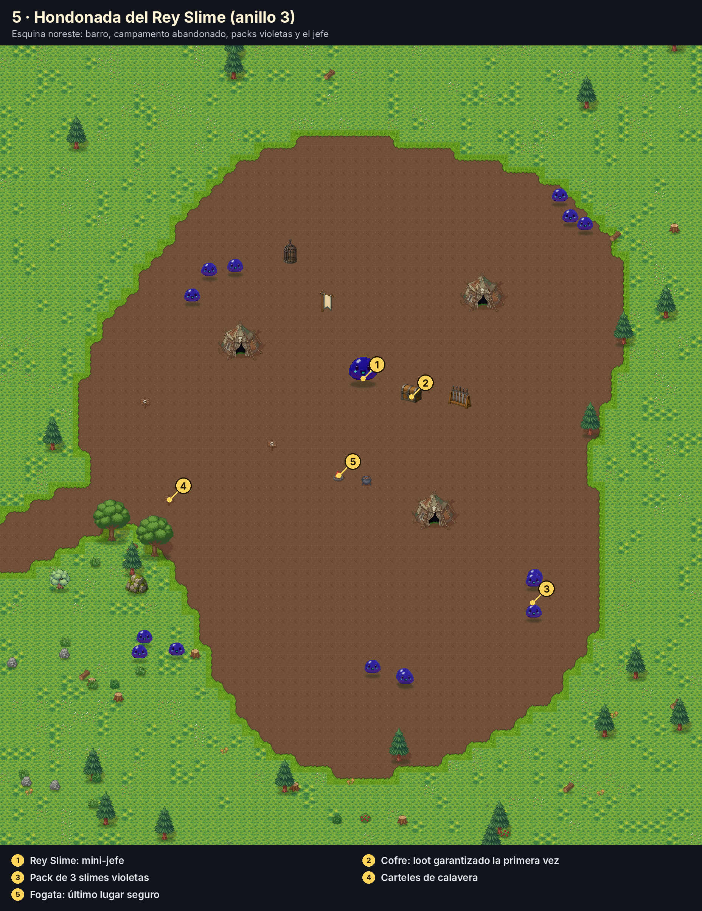

Barro, un campamento abandonado y carteles de calavera en la entrada. Los
slimes violetas van **en packs de 3**: acá se prueba si la build aguanta. El
jefe custodia un cofre.

- **Mobs:** 15 violetas en 5 packs.
- **Rey Slime:** hoy puede ser un `POIMarker` MINI_BOSS más un `MobSpawnMarker`
  con mucha vida. Que tenga patrones de verdad (embestida con telegraph,
  invocar slimes chicos) es trabajo de la milestone de enemigos (M2): esta zona
  es la que va a pedir esa IA.

---

## Enemigos (valores iniciales)

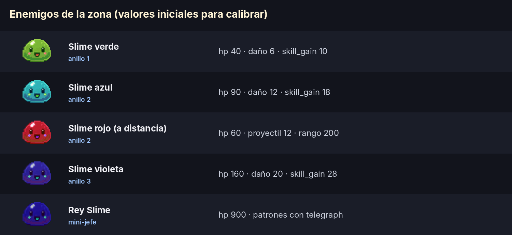

Todo esto se puede hacer **hoy, sin código nuevo**, con los `@export` de
`MobSpawnMarker` (`max_hp`, `speed`, `damage`, `skill_gain`, `gold_max`,
`ranged`, `body_color`, `projectile_damage`, `attack_range`, `attack_cooldown`).
El color de la ilustración es el `body_color` que distingue cada tipo.

| Tipo | max_hp | damage | speed | skill_gain | gold_max | Otros |
|---|---|---|---|---|---|---|
| Verde (anillo 1) | 40 | 6 | 85 | 10 | 2 | — |
| Azul (anillo 2) | 90 | 12 | 95 | 18 | 4 | (los defaults actuales) |
| Rojo (anillo 2) | 60 | 8 | 90 | 16 | 4 | `ranged`, `projectile_damage` 12, `attack_range` 200, `attack_cooldown` 1.3 |
| Violeta (anillo 3) | 160 | 20 | 110 | 28 | 8 | — |
| Rey Slime | 900 | 25 | 80 | 80 | 40 | Patrones: ver M2 |

Referencia para calibrar: el golpe base del jugador es 10 + 0,4 por punto de
skill (`BASE_MELEE_DAMAGE`, `MELEE_DAMAGE_PER_POINT`). Un verde muere en 4
golpes al empezar y en 2–3 hacia los 25 puntos. Esa sensación de "antes me
costaba" es justo la que la zona tiene que hacer notar.

Ojo con `DEBUG_GIVE_EVERYTHING := true` en `player.gd`: mientras esté
prendido, nada de esto se puede evaluar.

---

## El supermapa: una escena que crece por cuadrantes

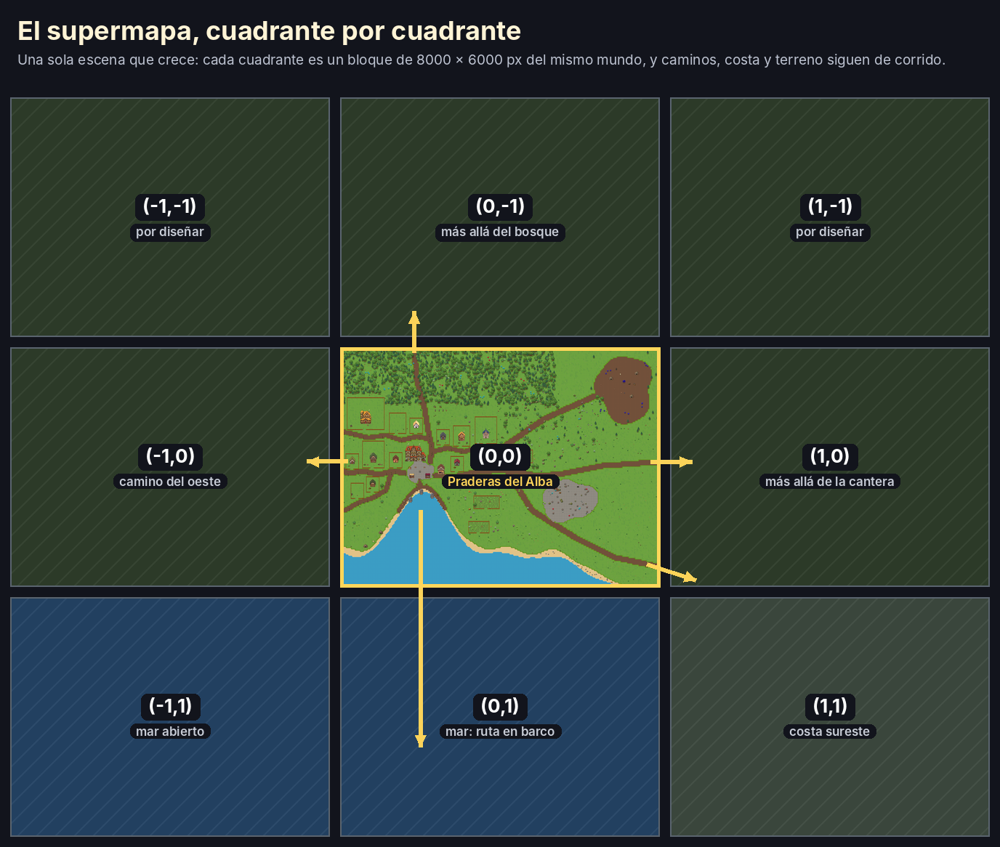

El mundo es **una sola escena** que se va agrandando. El cuadrante es la unidad
de trabajo: se diseña y se llena un bloque de 8000 × 6000 a la vez, y el
siguiente se pega al lado dentro de la misma escena, con caminos, costa y
terreno que siguen de corrido. Praderas del Alba es el cuadrante (0,0).

### Agrandar el mapa desde el mapper

**Pintar terreno afuera del borde agranda el mapa un cuadrante hacia ese
lado.** Vale para el TERRENO, el piso, los caminos y el pincel libre; un árbol,
un mob o una casa soltados afuera no agrandan nada (casi siempre es un click
errado). Con la herramienta activa, el editor dibuja el borde del mapa en
blanco, y con el cursor afuera muestra en amarillo el cuadrante que se
agregaría. Es un paso propio del Ctrl+Z: deshacerlo achica el mapa de nuevo.

Al agrandar:

- **Lo ya pintado no se mueve.** Antes, cambiar `world_size` copiaba la
  máscara de pintura en la esquina de arriba a la izquierda mientras la capa
  seguía centrada, y todo lo pintado se corría medio mapa. Ahora cada capa
  sabe qué rectángulo del mundo cubre y se reubica sin mover nada.
- **El mundo ya no está atado al origen.** La zona tiene `world_center` además
  de `world_size`, así que crecer al este no agranda también el oeste.
- **El pasto base se extiende solo,** con el mismo patrón, en el cuadrante
  nuevo. Puede tardar unos segundos: son ~47.000 celdas.
- Los límites del jugador en Play (`WorldBounds`) y la ubicación de los
  interiores siguen al mapa nuevo.

`quadrant_size` (8000 × 6000 por defecto) define cuánto crece por paso.

**Lo que queda pendiente es el tamaño de las máscaras de pintura.** Cada capa
del pincel libre que se usa reserva una máscara del tamaño de medio mundo:
48 MB por cuadrante. Con 3 × 3 cuadrantes serían 432 MB por capa, y una textura
no puede pasar de 16384 px de lado en la mayoría de las placas de video, o sea
unos 4 cuadrantes de ancho (el editor avisa si se pasa). Para crecer más que
eso, cada capa tiene que guardar una máscara por cuadrante, sin dejar de ser
una sola escena. El TERRENO y los caminos no tienen este límite: son celdas.

En juego, una escena grande no es problema en sí: los mobs ya se duermen
cuando el jugador está lejos (`chase_mob.gd`) y `TileMapLayer` dibuja por
bloques. Lo que más adelante va a necesitar el servidor es saber qué hay cerca
de cada jugador, y el cuadrante sirve también para eso.

Las salidas de Praderas del Alba (en amarillo en la vista general) marcan dónde
se pegan los cuadrantes vecinos: norte (bosque), oeste, este (más allá de la
cantera), sureste (la costa) y el mar, desde el puerto.

---

## Antes de armarla: dos arreglos técnicos

### Y-sort: quién se dibuja adelante

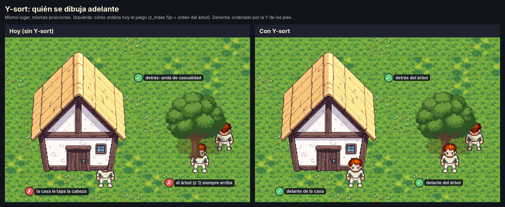

En una vista desde arriba en 3/4 como la del juego, **lo que está más abajo en
la pantalla está más cerca de la cámara** y se tiene que dibujar encima. El
Y-sort hace exactamente eso: Godot ordena a los hijos de un nodo por su
posición Y (la de los pies), en vez de por el orden en el árbol de escena.

Hoy el proyecto no lo usa en ningún lado. El orden sale de `z_index` y del
orden de los nodos:

- Las casas (`Z_BUILDING = 0`) se dibujan después del Player en
  `praderas_del_alba.tscn` (el Player está antes que `Markers` en el árbol),
  así que **la casa tapa al personaje aunque esté parado delante**.
- La decoración tiene `Z_DECOR = 1`, así que **un árbol o un barril tapan
  siempre al personaje**, esté delante o detrás.
- Mobs, jugador y recursos se ordenan según cuándo spawnearon.

Lo que hay que hacer para activarlo:

1. **Un mismo padre con `y_sort_enabled = true`** que contenga player, mobs,
   recursos, edificios y decoración (la raíz de la zona y `Markers`, por
   ejemplo; los nodos con Y-sort anidados se ordenan juntos).
2. **El mismo `z_index` para todo lo que tiene que ordenarse.** El Y-sort solo
   ordena dentro del mismo z: `Z_DECOR` y `Z_FENCE` tienen que bajar a 0. Los
   pisos (`Z_FLOOR`, `Z_TERRENO`, `Z_PINTURA`, `Z_SUELO`) se quedan en negativo
   porque siempre van abajo.
3. **El origen de cada cosa en la línea donde toca el piso.** Ya es la
   convención (anclado abajo-al-centro), pero hay que revisar el margen
   transparente. `house_small_a.png` tiene 16 px vacíos debajo de la pared:
   el origen está en 0 pero la pared termina en -16. Un personaje pegado a la
   pared (pies en -10) quedaría "detrás" de la casa. Se arregla corriendo el
   sprite 16 px para abajo (`offset.y`) y el collider con él.
4. **Las vallas** son una `TileMapLayer`: necesitan `y_sort_enabled` en la capa
   y que la capa sea parte del mismo ordenamiento. Con los lotes vallados, esto
   pasa a importar mucho más.

### La hitbox de la casa


El collider de `house_small_a.tscn` mide 126×56 y cubre **solo la pared**
(y de -72 a -16). El techo, que va de -208 a -72, es piso caminable. Como la
casa se dibuja encima del personaje, al caminar hacia arriba "entrás" en la
casa: es la sensación de atravesarla.

El README de edificios tiene razón en que el collider no debe cubrir el sprite
entero, porque si no la casa bloquea pasto por detrás. Pero el techo dibujado
**es la profundidad de la casa**, no aire. La propuesta:

- **Pared:** 126×56, como está.
- **Techo:** un segundo rectángulo de unos 150×78 (de y -150 a -72). Se deja
  libre la punta del techo para que, parado detrás, la casa te tape el cuerpo
  y asome la cabeza.

El `collider_editor` ya soporta varios rectángulos por edificio. La medida
exacta se ajusta a ojo con cada casa; con los lotes, alcanza con hacerlo una
vez por modelo de casa, no por lote.

---

## Cómo armarla sin volver a caer en el editor

1. **Y-sort + colliders de los edificios que se usan** (los modelos de casa de
   los lotes, posada, tienda, herrería, muelles). Nada más de tooling.
2. **Blockout:** pintar terrenos, costa y caminos, y poner markers de mobs,
   recursos, POIs y lotes. **Sin decoración.** Jugarla 30 minutos.
3. **Calibrar** con los números de arriba y el log de progresión.
4. **Recién ahí, vestirla:** bosque denso, props del pueblo, trigales, puerto,
   campamento.
5. **Regla para el editor:** solo se toca si bloquea *este* mapa, y como
   máximo durante una hora. Todo lo demás va a una lista. La única excepción
   razonable es un marker de lote (tamaño + casa actual) cuando llegue M6.

## Medir la progresión

Para calibrar sin adivinar hace falta un log mínimo. Cada vez que una skill
cruza 5/10/15/25/50/75 puntos, registrar minuto de juego, skill, puntos y
zona en la que estaba el jugador. Con la señal `Skills.skill_changed` alcanza;
se puede escribir a `user://progresion.csv`. Dos o tres partidas de una hora
dicen si la tabla de [El ritmo esperado](#el-ritmo-esperado) se cumple.

## Qué no entra en esta zona

- Barco y pesca (el puerto queda como decorado).
- Comprar lotes, impuesto y subir de tier (M6): los lotes se dibujan, pero
  todavía no se compran.
- Mazmorra (va en el próximo cuadrante, M7).
- Diálogos de NPCs (M4): por ahora los POIs son marcadores.

---

## Cómo regenerar las ilustraciones

```bash
pip install pillow
python3 art_pipeline/zona_inicial/render_zona.py . docs/img/zona_inicial
```

El script lee el arte de `game/assets/`, arma el terreno con el mismo algoritmo
que `BiomeTileset.resolve()`, coloca todo ordenado por Y y genera las láminas.
El layout (calles, lotes, mobs) está escrito en el script, en tiles; los lotes
se apoyan solos sobre su calle y el script avisa si algo se pisa. Si cambia el
diseño, se cambia ahí y se regenera.
