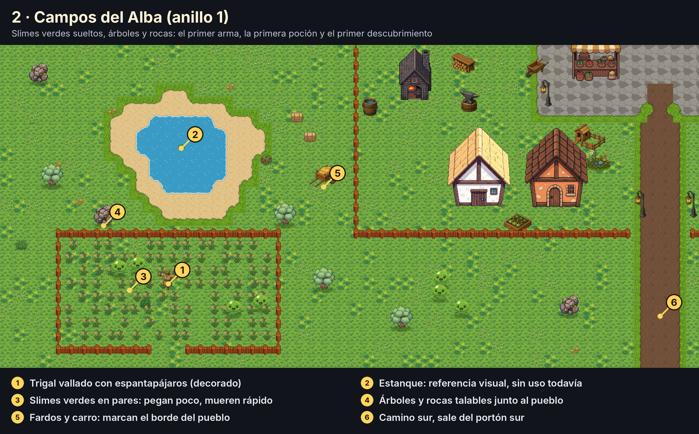
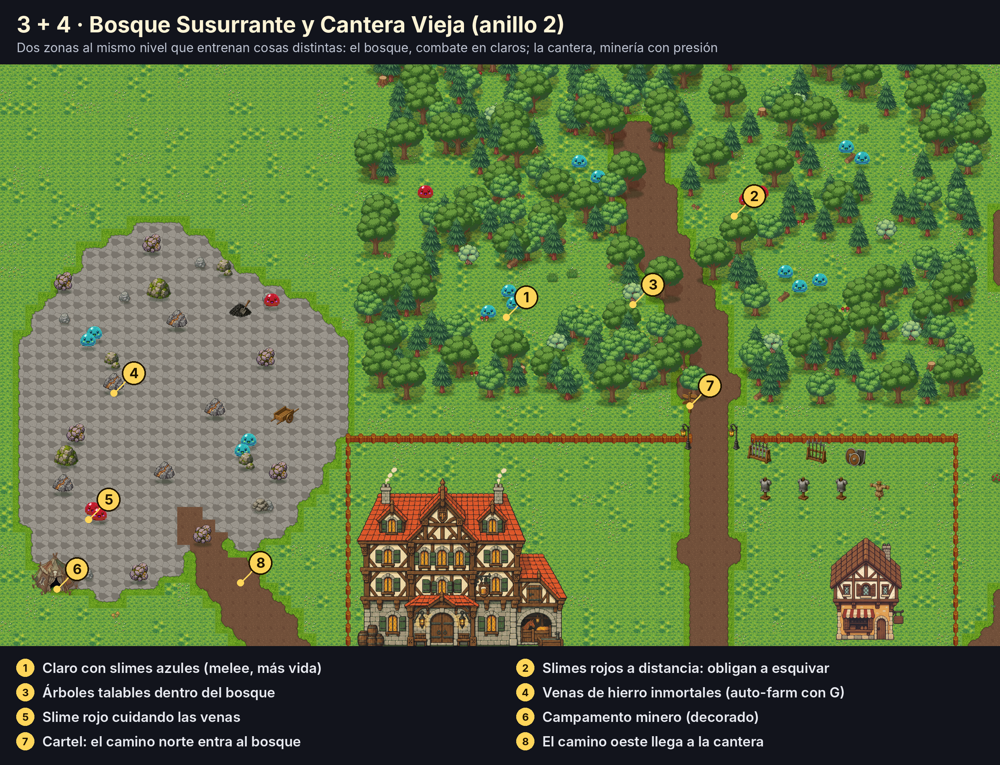
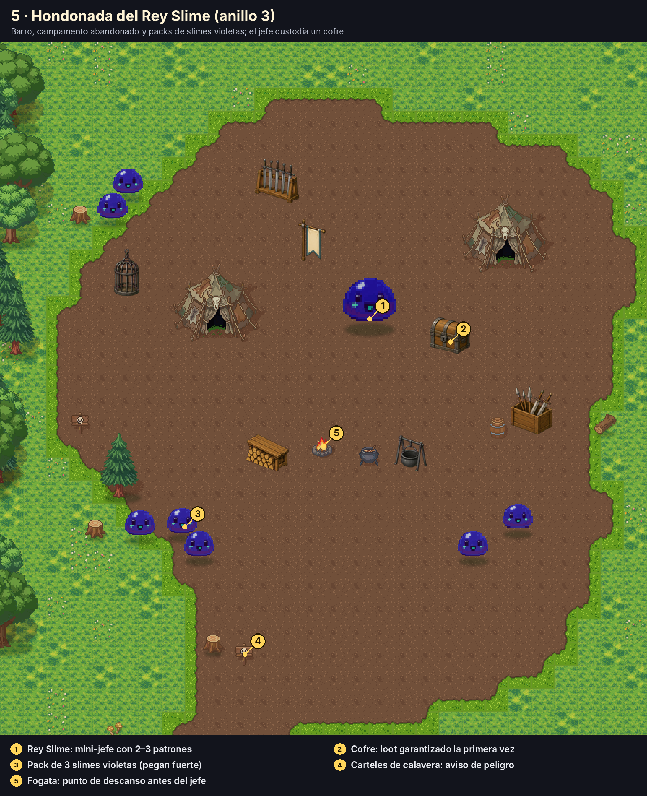
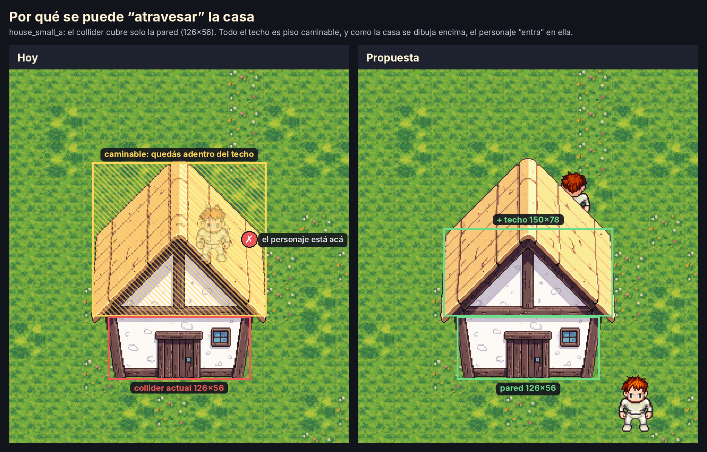

# Zona inicial — Praderas del Alba

> Diseño de la zona donde se prueba la progresión. Es un plan para armar en el
> editor, no algo ya implementado. Las ilustraciones están hechas con el arte
> real del mapeador (`game/assets/`), con el mismo autotile de terreno
> (`BiomeTileset`) y de vallas (`FenceAutotiler`) que usa el juego. Ver
> [Cómo regenerar las ilustraciones](#cómo-regenerar-las-ilustraciones).
>
> Algunas piezas son **provisorias** y se van a reemplazar: la herrería, los
> puestos de mercado y el muelle. Están puestas para ocupar su lugar en el mapa.


Mapa completo a escala 1:1 (3328×2560, para mapear mirándolo al lado):
[`00_mapa_completo.png`](img/zona_inicial/00_mapa_completo.png).

---

## Para qué existe esta zona

Hoy "Nuevo Juego" abre `praderas_del_alba.tscn`, que tiene 6 casas y ningún mob
ni recurso. El loop jugable vive en `pradera.tscn`, que es una zona de prueba.
Esta zona tiene que reemplazar a las dos y contestar, jugándola, estas preguntas:

1. **¿Se siente el avance?** Volver al anillo 1 después de una hora tiene que
   sentirse fácil.
2. **¿El primer descubrimiento "1 de 3" llega a tiempo?** Tiene que pasar antes
   de que el jugador se aburra del anillo 1.
3. **¿Cada anillo pide algo distinto?** No "lo mismo con más vida": cada zona
   entrena una habilidad del jugador (pegar, esquivar, gestionar recursos).
4. **¿Vale la pena volver al pueblo?** Vender, craftear, curarse y guardar
   tienen que estar a pocos pasos.
5. **¿El farm activo le gana al AFK?** Las venas con G contra el golpe a mano
   (+20%).

## Tamaño y estructura

- **104 × 80 tiles (3328 × 2560 px)**. La zona actual mide 2400 × 1800
  (`world_size` en `world_zone.gd`), así que hay que agrandarla. Es más chica
  de lo que parece: cruzarla de punta a punta a 200 px/s lleva unos 17 s.
- **Anillos de dificultad alrededor del pueblo**: el pueblo en el centro, el
  anillo 1 pegado a él, el anillo 2 a la salida de los portones y el anillo 3
  en una esquina. Así el pueblo siempre queda cerca y "más lejos" es
  "más peligroso" sin tener que explicarlo.
- **Cuatro portones, cuatro caminos de tierra** (pincel TERRENO → barro). El
  camino es el tutorial: seguirlo te lleva de una zona a la siguiente.

| # | Zona | Anillo | Skill objetivo (puntos) | Qué entrena |
|---|---|---|---|---|
| 1 | Pueblo del Alba | seguro | — | Volver, vender, craftear, guardar |
| 2 | Campos del Alba | 1 | 0 → 15 | Los controles: pegar, recolectar, primer craft |
| 3 | Bosque Susurrante | 2 | 15 → 40 | Combate contra varios, esquivar proyectiles |
| 4 | Cantera Vieja | 2 | 15 → 40 | Minería (venas inmortales) bajo presión |
| 5 | Hondonada del Rey Slime | 3 | 40+ | Grupos fuertes + mini-jefe |
| 6 | Lago y muelle | — | — | Reservado para pesca (no entra ahora) |

## El ritmo esperado

Estos tiempos son **un objetivo para calibrar**, no un cálculo. Cuánto se tarda
de verdad depende de `skill_gain`, de la curva de rendimientos decrecientes de
`Skills` y de cuánto tarda en morir cada mob. La idea es medirlo (ver
[Medir la progresión](#medir-la-progresión)) y mover los números hasta que
se parezca a esta tabla.

| Minuto | Dónde | Qué debería pasar |
|---|---|---|
| 0–5 | Pueblo → Campos | Primeros slimes verdes, primer árbol talado, primera vuelta a vender |
| 5–15 | Campos | Crafteo del primer arma en la herrería. ~15 pts en la skill de combate |
| 15–25 | Bosque o Cantera | **Primer descubrimiento (25 pts)**. Primeros slimes rojos: aprender a esquivar |
| 25–45 | Bosque y Cantera | Gear de hierro con las venas. **Segundo descubrimiento (50 pts)** |
| 45–60 | Hondonada | Packs violetas, primer intento al Rey Slime. Volver al anillo 1 se siente trivial |
| 60+ | Hondonada | Matar al jefe. **Tercer descubrimiento (75 pts)** |

Los umbrales 25/50/75 son los que ya usa `player.gd`
(`DISCOVERY_THRESHOLDS`) para Espadas Pesadas, Hechicería y Puntería.

---

## 1 · Pueblo del Alba


Todo lo que se necesita entre salida y salida, a menos de 15 segundos de la
plaza. Es zona segura: no spawnea nada adentro del vallado.

| Pieza | Arte | En el blockout | Qué hace después (milestone) |
|---|---|---|---|
| Posada | `inn` | Punto de spawn | Respawn al morir + guardado (M1) |
| Tienda | `general_goods` | `POIMarker` tipo VENDOR, solo visual | Vender loot, comprar pociones (M4) |
| Herrería | `blacksmith_n` *(provisoria)* | `POIMarker` tipo REPAIR | El crafteo pasa a requerir estar acá, en vez de la tecla C en cualquier lado (M4) |
| Tu casa | `house_small_a` | Ya tiene puerta e interior (`interior_small`) | Cofre y muebles (M6) |
| Tablón de encargos | `mega_quest_board_parchment_blank` | Decorado | Primer NPC de quests: "matá X / traeme Y" (M4) |
| Patio de entrenamiento | `mega_armor_stand_breastplate`, racks | `training_dummy` para probar kits | Igual. **No dan skill**: solo suben al matar, recolectar o craftear |
| Puestos de mercado | `market_produce`, `market_spices` *(provisorios)* | Decorado | Vendedores especializados |
| Casas restantes | `house_small_c/d/e/f` | Decorado | Lotes de housing (M6) |

**Lo mínimo para la primera versión jugable:** posada, herrería, tu casa,
vallado con colisión y portones. Lo demás puede ser decorado.

Todas las casas que se usen necesitan su escena con collider
(`tools/collider_editor.tscn`). Son 11 (8 edificios, 2 puestos y el muelle), no los 45 del catálogo.

---

## 2 · Campos del Alba (anillo 1)



El primer contacto. Slimes de a dos, lejos del camino para que el jugador
elija cuándo pelear. Árboles y rocas pegados al vallado para que el primer
crafteo salga sin alejarse.

- **Mobs:** 12–14 slimes verdes en pares.
- **Recursos:** 6 árboles y 4 rocas (no inmortales, respawn de ~6 s).
- **Decorado:** trigal vallado con espantapájaros, estanque, fardos.

---

## 3 + 4 · Bosque Susurrante y Cantera Vieja (anillo 2)



Dos zonas del mismo nivel que piden cosas distintas, para que haya una
elección real:

**Bosque Susurrante (norte).** Árboles decorativos densos que funcionan como
pared y dejan **claros** donde están los packs. Los claros de 3–4 tiles
hacen que el combate sea en espacios chicos. Slimes azules (melee, más vida)
en grupos de 3, y slimes rojos a distancia cubriéndolos desde el borde del
claro: el primer lugar donde esquivar importa. Árboles talables adentro, para
que la Tala tenga su zona.

**Cantera Vieja (oeste).** Terreno de piedra (TERRENO → piedra) con rocas y las
**5 venas de hierro inmortales**. Cada vena tiene cerca un slime rojo o un par
de azules: el auto-farm con G es cómodo, pero te interrumpen. Así el
"manual rinde +20%" se combina con "manual te deja reaccionar".

- **Mobs bosque:** 10 azules en 4 packs + 3 rojos.
- **Mobs cantera:** 4 azules + 3 rojos.
- **Recursos:** 8 árboles en el bosque, 7 rocas y 5 venas inmortales en la cantera.

---

## 5 · Hondonada del Rey Slime (anillo 3)



Barro, un campamento abandonado y carteles de calavera en la entrada. Los
slimes violetas van **en packs de 2–3**: es donde se prueba si la build
que armaste aguanta. El jefe custodia un cofre.

- **Mobs:** 7 violetas en 3 packs.
- **Rey Slime:** hoy puede ser un `POIMarker` MINI_BOSS más un `MobSpawnMarker`
  con mucha vida. Que tenga patrones de verdad (embestida con telegraph,
  invocar slimes chicos) es trabajo de la milestone de enemigos (M2): esta
  zona es la que va a pedir esa IA.
- **Fogata:** el último lugar seguro antes del jefe. Por ahora es decorado.

---

## Enemigos (valores iniciales)


Todo esto se puede hacer **hoy, sin código nuevo**, con los `@export` de
`MobSpawnMarker` (`max_hp`, `speed`, `damage`, `skill_gain`, `gold_max`,
`ranged`, `body_color`, `projectile_damage`, `attack_range`, `attack_cooldown`).
El color de la ilustración es el `body_color` que distingue cada tipo.

| Tipo | max_hp | damage | speed | skill_gain | gold_max | Otros |
|---|---|---|---|---|---|---|
| Verde (anillo 1) | 40 | 6 | 85 | 10 | 2 | — |
| Azul (anillo 2) | 90 | 12 | 95 | 18 | 4 | (los defaults actuales) |
| Rojo (anillo 2) | 60 | 8 | 90 | 16 | 4 | `ranged`, `projectile_damage` 12, `attack_range` 200, `attack_cooldown` 1.3 |
| Violeta (anillo 3) | 160 | 20 | 110 | 28 | 8 | — |
| Rey Slime | 900 | 25 | 80 | 80 | 40 | Patrones: ver M2 |

Referencia para calibrar: el golpe base del jugador es 10 + 0,4 por punto de
skill (`BASE_MELEE_DAMAGE`, `MELEE_DAMAGE_PER_POINT`). Un verde muere en 4
golpes al empezar y en 2–3 hacia los 25 puntos. Esa sensación de "antes me
costaba" es justo la que la zona tiene que hacer notar.

Ojo con `DEBUG_GIVE_EVERYTHING := true` en `player.gd`: mientras esté
prendido, nada de esto se puede evaluar.

---

## Antes de armarla: dos arreglos técnicos

### Y-sort: quién se dibuja adelante


En una vista desde arriba en 3/4 como la del juego, **lo que está más abajo en
la pantalla está más cerca de la cámara** y se tiene que dibujar encima. El
Y-sort hace exactamente eso: Godot ordena a los hijos de un nodo por su
posición Y (la de los pies), en vez de por el orden en el árbol de escena.

Hoy el proyecto no lo usa en ningún lado. El orden sale de `z_index` y del
orden de los nodos:

- Las casas (`Z_BUILDING = 0`) se dibujan después del Player en
  `praderas_del_alba.tscn` (el Player está antes que `Markers` en el árbol),
  así que **la casa tapa al personaje aunque esté parado delante**.
- La decoración tiene `Z_DECOR = 1`, así que **un árbol o un barril tapan
  siempre al personaje**, esté delante o detrás.
- Mobs, jugador y recursos se ordenan según cuándo spawnearon.

Lo que hay que hacer para activarlo:

1. **Un mismo padre con `y_sort_enabled = true`** que contenga player, mobs,
   recursos, edificios y decoración (la raíz de la zona y `Markers`, por
   ejemplo; los nodos con Y-sort anidados se ordenan juntos).
2. **El mismo `z_index` para todo lo que tiene que ordenarse.** El Y-sort solo
   ordena dentro del mismo z: `Z_DECOR` y `Z_FENCE` tienen que bajar a 0. Los
   pisos (`Z_FLOOR`, `Z_TERRENO`, `Z_PINTURA`, `Z_SUELO`) se quedan en negativo
   porque siempre van abajo.
3. **El origen de cada cosa en la línea donde toca el piso.** Ya es la
   convención (anclado abajo-al-centro), pero hay que revisar el margen
   transparente. `house_small_a.png` tiene 16 px vacíos debajo de la pared:
   el origen está en 0 pero la pared termina en -16. Un personaje pegado a la
   pared (pies en -10) quedaría "detrás" de la casa. Se arregla corriendo el
   sprite 16 px para abajo (`offset.y`) y el collider con él.
4. **Las vallas** son una `TileMapLayer`: necesitan `y_sort_enabled` en la capa
   y que la capa sea parte del mismo ordenamiento.

### La hitbox de la casa



El collider de `house_small_a.tscn` mide 126×56 y cubre **solo la pared**
(y de -72 a -16). El techo, que va de -208 a -72, es piso caminable. Como la
casa se dibuja encima del personaje, al caminar hacia arriba "entrás" en la
casa: es la sensación de atravesarla.

El README de edificios tiene razón en que el collider no debe cubrir el sprite
entero, porque si no la casa bloquea pasto por detrás. Pero el techo dibujado
**es la profundidad de la casa**, no aire. La propuesta:

- **Pared:** 126×56, como está.
- **Techo:** un segundo rectángulo de unos 150×78 (de y -150 a -72). Se deja
  libre la punta del techo para que, parado detrás, la casa te tape el cuerpo
  y asome la cabeza.

El `collider_editor` ya soporta varios rectángulos por edificio. La medida
exacta se ajusta a ojo con cada casa.

---

## Cómo armarla sin volver a caer en el editor

1. **Y-sort + colliders de los 11 edificios que se usan.** Nada más de tooling.
2. **Blockout:** agrandar `world_size`, pintar los cuatro terrenos y los
   caminos, y poner markers de mobs, recursos, POIs y casas. **Sin
   decoración.** Jugarla 30 minutos.
3. **Calibrar** con los números de arriba y el log de progresión.
4. **Recién ahí, vestirla:** bosque denso, props del pueblo, trigal, campamento.
5. **Regla para el editor:** solo se toca si bloquea *este* mapa, y como
   máximo durante una hora. Todo lo demás va a una lista.

## Medir la progresión

Para calibrar sin adivinar hace falta un log mínimo. Cada vez que una skill
cruza 5/10/15/25/50/75 puntos, registrar minuto de juego, skill, puntos y
zona en la que estaba el jugador. Con la señal `Skills.skill_changed` alcanza;
se puede escribir a `user://progresion.csv`. Dos o tres partidas de una hora
dicen si la tabla de [El ritmo esperado](#el-ritmo-esperado) se cumple.

## Qué no entra en esta zona

- Pesca (el lago y el muelle quedan reservados).
- Mazmorra (va en la segunda zona, M7).
- Diálogos de NPCs (M4): por ahora los POIs son marcadores.
- Interior decorable de la casa (M6).

---

## Cómo regenerar las ilustraciones

```bash
pip install pillow
python3 art_pipeline/zona_inicial/render_zona.py . docs/img/zona_inicial
```

El script lee el arte de `game/assets/`, arma el terreno con el mismo algoritmo
que `BiomeTileset.resolve()`, coloca todo ordenado por Y y genera las láminas.
El layout (dónde va cada cosa) está escrito en el script, en tiles. Si se cambia
el diseño, se cambia ahí y se regenera.
